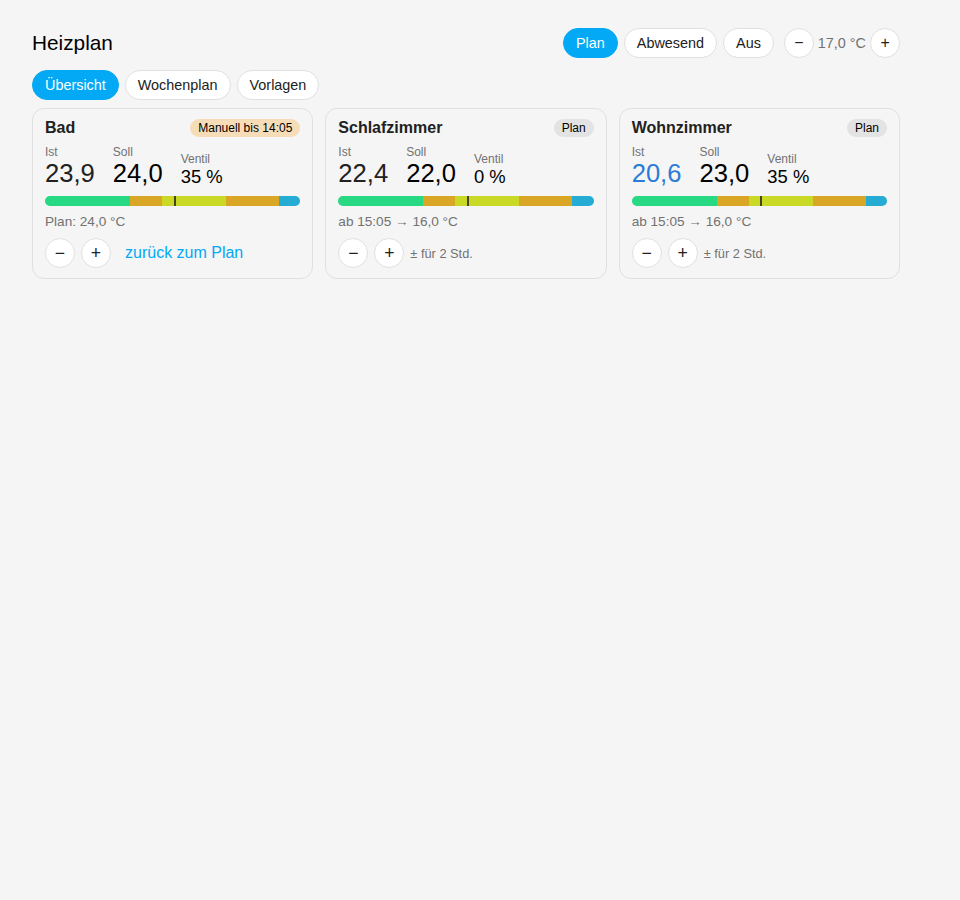
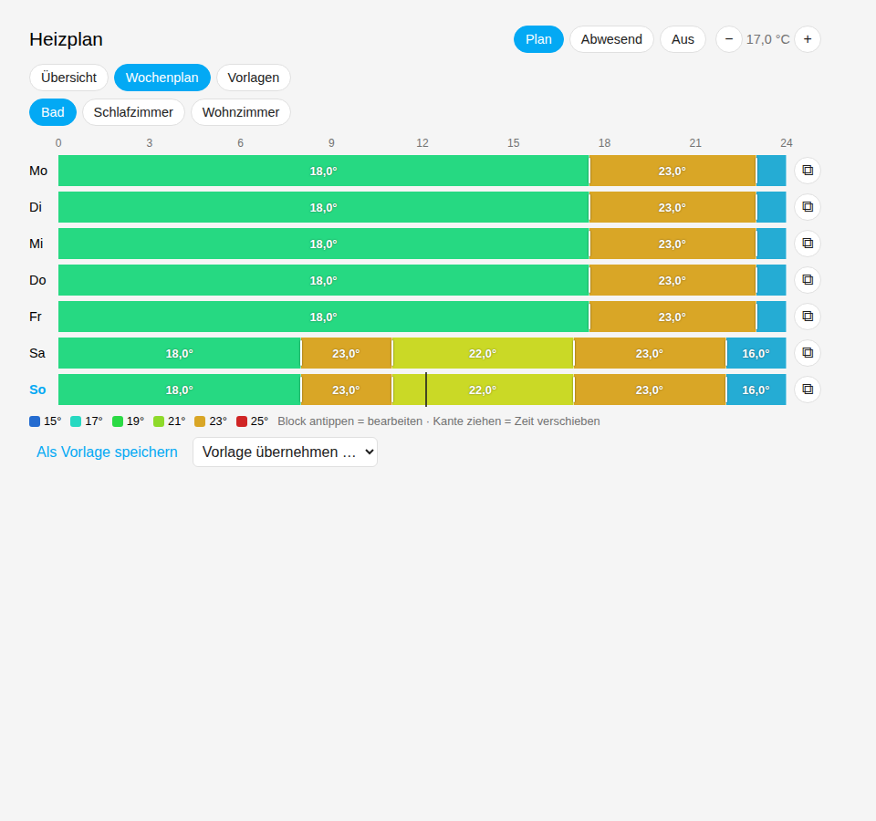
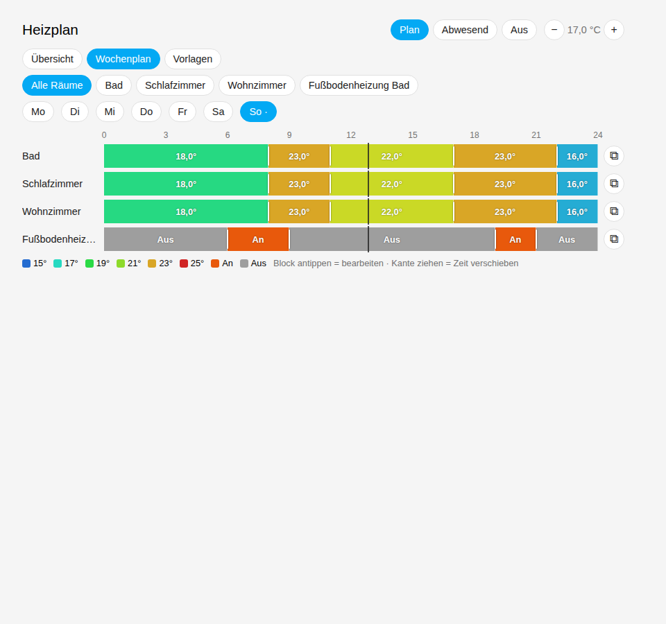

# Heizplan für Home Assistant

Wochenpläne für Heizungen mit **echter Solltemperatur**: Die Raumregler bleiben auf
*Komfort*, Heizplan schreibt zu jeder Zeit genau den Wert, der gerade gelten soll.
Was in der Karte als **Soll** steht, wird auch geregelt – kein Rätseln mehr über
Standby-/Nacht-Absenkungen im Regler.





## Funktionen

- **Übersicht aller Räume** – Ist, Soll, Quelle (Plan / Manuell / Abwesend), Ventil %, Tagesverlauf, nächster Wechsel
- **Alle Räume auf einen Blick** – ein Tag (Mo–So wählbar), alle Räume untereinander, direkt bearbeitbar
- **Wochenraster je Raum** – Blöcke antippen zum Ändern, Kanten ziehen zum Verschieben (15-min-Raster), Tag auf andere Tage kopieren
- **Vorlagen** – Plan eines Raums als Vorlage speichern, auf beliebige Räume anwenden
- **Kurzzeit-Überschreiben** – ± in der Übersicht: 2 Stunden wärmer/kühler, danach automatisch zurück zum Plan
- **Modus** Wochenplan / Abwesend (feste Temperatur) / Aus
- **Heizperiode**: optional eine Entity (z. B. `switch.heizperiode`) – ist sie aus, schreibt Heizplan nichts
- Je Raum ein Sensor `sensor.heizplan_<raum>_soll` mit Attributen (Quelle, Block, nächster Wechsel, Ist, Ventil)
- **Schalt-Räume** (z. B. elektrische Fußbodenheizung über `switch.*`): Blöcke mit An/Aus statt Temperatur, eigene aktive Monate, optional unabhängig von der Heizperiode (`heizplan.update_room`)
- **Heizperiode-Automatik** (Reiter „Heizperiode“ in der Karte): *Manuell*, *Nach Datum* (z. B. an 01.10., aus 01.05.) oder *Nach Wetter* (an, wenn an allen nächsten N Tagen das Tagesmittel unter X °C liegt; aus, wenn über Y °C – Standard 6 Tage, 10 °C / 15 °C). Geschaltet wird nur bei einem neuen Ergebnis, Hand-Schaltung wird nicht gleich überstimmt
- Übernahme bestehender Zeitpläne aus dem *Scheduler-Component* (`heizplan.import_scheduler`) – Temperatur- und An/Aus-Zeitpläne

## Installation (HACS)

1. HACS → ⋮ → *Benutzerdefinierte Repositories* → `https://github.com/PatrickHennigBerlin/ha-heizplan`, Typ **Integration**
2. *Heizplan* herunterladen, Home Assistant neu starten
3. Einstellungen → Geräte & Dienste → *Integration hinzufügen* → **Heizplan**
   - Heizperiode-Entity wählen (optional)
   - „Regler auf Komfort halten“ aktiv lassen
4. Karte ins Dashboard: `type: custom:heizplan-card` (die Karte wird von der Integration mitgeliefert, keine extra Ressource nötig)

## Karte

```yaml
type: custom:heizplan-card
title: Heizung            # optional
view: overview            # overview | week | templates | season
room: lounge              # optional: Startraum im Wochenplan
rooms: [lounge, kuechewindow, schlafzimmer]   # optional: Reihenfolge/Auswahl
hide_tabs: false
```

## Dienste

| Dienst | Zweck |
|---|---|
| `heizplan.set_mode` | `plan`, `away`, `off` |
| `heizplan.set_override` | Raum (Entity, Raum-ID oder Name), `temperature` bzw. `on`, Minuten |
| `heizplan.clear_override` | Raum zurück auf den Plan |
| `heizplan.update_room` | Name, Ventil-Sensor, `follow_season`, aktive `months` (z. B. Fußbodenheizung nur Okt–Apr) |
| `heizplan.set_season_auto` | Heizperiode-Automatik: `mode` (`manual`/`dates`/`weather`), `on_date`/`off_date` (TT.MM), `weather_entity`, `on_below`, `off_above`, `days`, `basis` (`mean`/`max`/`min`) |
| `heizplan.update_room` (Zuheizen) | `aux_climate` (climate-Entität), `aux_fan_mode` **oder** `aux_fan_switch`, `aux_enabled` – leerer Text entfernt |
| `heizplan.set_aux` | Zuheizen global: `on_delta`, `off_delta`, `wait`, `outside_limit`, `takeover` |
| `heizplan.import_scheduler` | `switch.schedule_*` übernehmen (`climate.set_temperature` und `switch.turn_on/off`; `workday` = Mo–Fr) |

Beispiel „Außer Haus“: `heizplan.set_mode` mit `mode: away`; bei Rückkehr `mode: plan`.

## Wie geschrieben wird

- Jede Minute wird je Raum der Sollwert berechnet: *Override* → *Abwesend* → *Wochenplan*.
- Geschrieben wird nur bei einer Änderung (Blockwechsel, Bearbeitung, Modus) und beim Start –
  eine manuelle Änderung am Thermostat bleibt also bis zum nächsten Blockwechsel bestehen.
- **Regler immer auf Komfort** (abschaltbar): Steht ein aktiver Raum auf Standby, Nacht oder Frostschutz – z. B. weil der Regler nach einem Busausfall neu startet –, stellt Heizplan ihn spätestens nach einer Minute auf Komfort und schreibt den Plan-Sollwert neu. Reagiert ein Regler nicht, wird höchstens alle 5 Minuten erneut versucht.
- Ist die Heizperiode aus (Raum inaktiv), wird nichts korrigiert – Frostschutz im Sommer bleibt.
- Beim **Start von Home Assistant** und beim **Einschalten der Heizperiode** werden alle Regler sofort auf Komfort gestellt.
- Werte werden auf `min_temp`/`max_temp` der climate-Entity begrenzt.

## Zuheizen mit Klima

Hat ein Raum zusätzlich ein Klimagerät (climate-Entität mit `heat`), kann Heizplan es mitheizen lassen,
wenn die Heizung allein den Soll nicht schafft. Einrichten je Raum mit `heizplan.update_room`:

```yaml
action: heizplan.update_room
data:
  room: climate.wohnzimmer_heizung
  aux_climate: climate.klima_wohnzimmer
  aux_fan_mode: auto            # Lüfterstufe aus fan_modes – oder:
  # aux_fan_switch: switch.lufter_auto_wohnzimmer
```

- **Ein**, wenn *durchgehend für die Wartezeit* (Standard 10 min) gilt: Raum aktiv (Heizperiode, Modus nicht Aus),
  Zuheizen für den Raum erlaubt, **Soll − Ist ≥ Abweichung** (Standard 1,5 K) und – falls ein Außenfühler
  eingestellt ist – außen kälter als die **Außengrenze** (Standard 10 °C). Ist der Außenfühler nicht verfügbar,
  wird nicht zugeheizt.
- Dann: `climate.set_temperature` mit `hvac_mode: heat` und dem Raum-Soll (auf `min_temp`/`max_temp` und
  `target_temp_step` des Klimageräts gebracht), danach Lüfterstufe bzw. Lüfter-Schalter.
- **Aus**, sobald **Ist ≥ Soll − Abschaltabstand** (Standard 0,5 K) oder eine Einschaltbedingung wegfällt –
  nur, wenn die Klima gerade auf `heat` steht. Dazwischen bleibt der Zustand (Hysterese).
- **Soll folgt:** Ändert sich der Raum-Soll (Plan, Override, Abwesend), wird der Klima-Soll nachgezogen.
- **Klima übernehmen** (Standard an): Auch eine laufende Klima (z. B. Kühlen/Lüften) wird bei Bedarf auf Heizen
  gestellt und später ausgeschaltet. Aus: nur einschalten, wenn die Klima aus ist, und nur ausschalten, was
  Heizplan selbst eingeschaltet hat.
- Wird die Klima während des Zuheizens von Hand aus- oder umgestellt, pausiert das Zuheizen für den Raum,
  bis es wieder warm genug ist.
- Nach einem Neustart wird neu bewertet; die Wartezeit beginnt neu, laufendes Zuheizen wird nicht blind beendet.

Entitäten: `number.heizplan_zuheizen_abweichung`, `…_abschaltabstand`, `…_wartezeit`, `…_aussengrenze`,
`switch.heizplan_zuheizen_klima_ubernehmen`, je Raum `switch.heizplan_zuheizen_<raum>` (erlauben) und
`binary_sensor.heizplan_zuheizen_<raum>` (aktiv). Den Außenfühler wählt man in den Optionen der Integration.
Die Karte zeigt „Klima“ am Raum, solange mitgeheizt wird.

### Auxiliary heating with an A/C (English)

Assign an A/C (`aux_climate`) to a room. It is switched to `heat` with the room target when
target − actual ≥ deviation for the delay time (and outdoor < limit, if an outdoor sensor is configured),
and switched off at actual ≥ target − margin. Settings are entities of the integration; the outdoor
sensor is set in the integration options.

## Entwicklung

```bash
pip install pytest-homeassistant-custom-component
pytest
```

Lizenz: MIT
